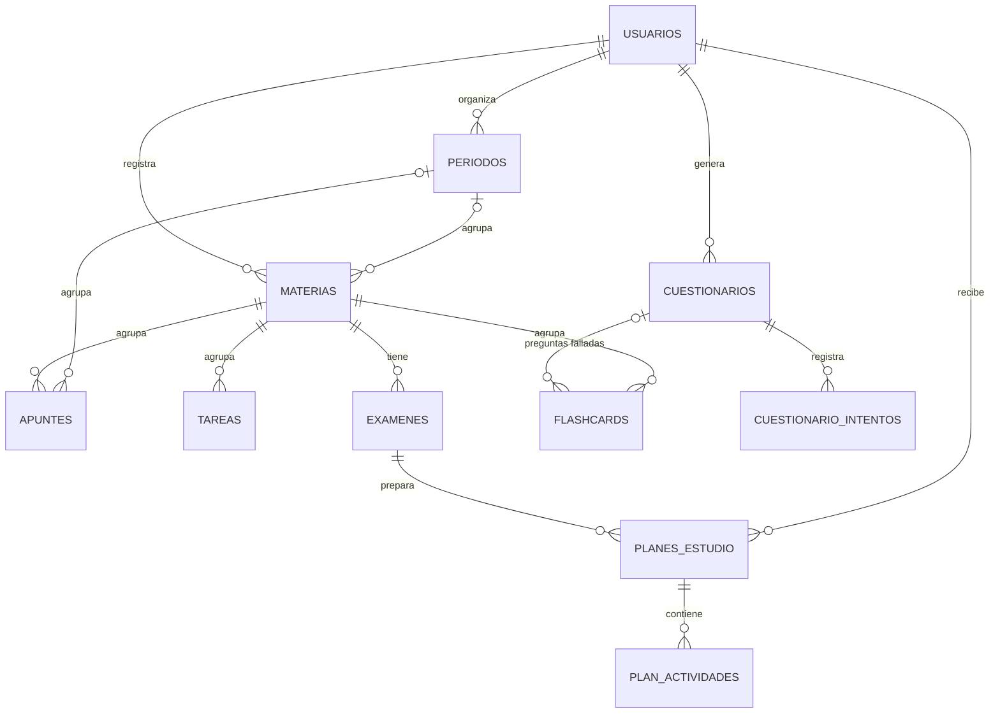

<p align="center"></p>

# EduPlan

**Sistema web para la organización académica con asistente de IA**

Universidad Mariano Gálvez de Guatemala · Desarrollo Web I · Ing. Guillermo Pisqui · Proyecto Final

---

## Descripción

EduPlan es una aplicación web basada en **microservicios** que reúne en un solo lugar las materias, tareas, exámenes y apuntes de un estudiante, y lo ayuda a estudiar con **inteligencia artificial**: resume apuntes, crea planes de estudio por día, genera cuestionarios de práctica y tarjetas de memoria con repaso espaciado.

El acceso se hace con **OAuth 2.0 (Google)** o con **correo y contraseña**, y la sesión se mantiene con **JSON Web Tokens (JWT)** con expiración. Dos microservicios independientes (autenticación y gestión académica) se exponen a través de un **proxy inverso Nginx** y comparten una base de datos **PostgreSQL** con tablas separadas por servicio.

**Público objetivo:** estudiantes de nivel medio y universitario.

## Funcionalidades

| Área | Qué puede hacer el estudiante |
|---|---|
| Acceso | Entrar con Google o con correo y contraseña; cerrar sesión de forma segura |
| Panel | Ver lo de hoy: sesiones de estudio, próximos exámenes, tarjetas por repasar, tareas atrasadas y agenda de la semana |
| Calendario | Tareas, exámenes y sesiones de estudio en vista mensual, semanal o diaria |
| Tareas | Crear, editar y filtrar por materia, estado, prioridad y fecha. **Completar pide confirmación y es definitivo** |
| Exámenes | Registrar fecha y temas, crear un plan de preparación y practicar con cuestionarios |
| Materias | Agrupadas por **semestre o bloque**; pendientes, completadas, vencidas, avance, próximo examen, apuntes y tarjetas |
| Apuntes | Organizados por **semestre, bloque o carpeta → materia**, con favoritos, etiquetas y vistas *Recientes*, *Favoritos* y *Por repasar*; lectura con formato y código; **resumen con IA** |
| Plan de estudio (IA) | **Asistente en 3 pasos** (objetivo, disponibilidad, confirmación): elegir materia, semestre, temas, temas a priorizar y prioridad; **vista previa editable** antes de guardar; marcar avance y **reorganizar la semana** |
| Cuestionarios (IA) | Preguntas sobre los apuntes **o temas elegidos** de una materia o examen; calificación con explicaciones y después: temas fallados, **apuntes recomendados**, **tarjetas de las preguntas falladas**, **sesión de repaso en el plan** y **comparación con el intento anterior** |
| Tarjetas de memoria (IA) | Escritas a mano o generadas desde un apunte; **repaso espaciado** (No lo recuerdo / Difícil / Fácil) con **Atrás y Siguiente** |
| Alertas | Avisos de vencimientos, exámenes, actividades atrasadas y repasos; notificaciones del navegador con permiso |
| Administración | Estado de los microservicios, la base de datos y la IA (rol administrador) |

## Diagrama de arquitectura


Recorrido de una petición: el navegador resuelve `eduplan.com` por DNS y abre una conexión HTTPS con Nginx, que es el único contenedor expuesto. Nginx entrega el frontend y enruta `/auth/*` a **ms-auth** y `/api/*` a **ms-academico**. ms-auth valida la identidad (Google o contraseña) y emite el JWT; ms-academico valida el JWT en cada petición, consulta PostgreSQL y llama a la API de IA cuando se pide un resumen, un plan, un cuestionario o tarjetas.

## Microservicios

### ms-auth · Autenticación y usuarios (Node.js + Express · puerto 3001)
| Método | Ruta | Descripción | Req. |
|---|---|---|---|
| GET | `/auth/google` · `/auth/google/callback` | Inicio de sesión con Google (OAuth 2.0) y emisión del JWT | RF01, RF02 |
| POST | `/auth/registro` | Crear cuenta con correo y contraseña (hash scrypt) | RF01 |
| POST | `/auth/login` | Iniciar sesión con correo y contraseña (máx. 5 intentos fallidos / 15 min) | RF01, RF02 |
| GET | `/auth/me` | Perfil del usuario del token | RF02 |
| POST | `/auth/logout` | Cierre de sesión; el cliente elimina el JWT | RF11 |
| GET | `/auth/health` · `/auth/docs` | Estado del servicio · Swagger | HU10 |

Esquema de BD: `auth`. Detalle en **[ms-auth/README.md](ms-auth/README.md)**.

### ms-academico · Gestión académica e IA (Node.js + Express · puerto 3002)
| Recurso | Rutas principales | Req. |
|---|---|---|
| Materias | `GET/POST /api/materias` · `GET/PUT/DELETE /api/materias/:id` | RF03 |
| Tareas | `GET/POST /api/tareas` (filtros) · `PUT/DELETE /api/tareas/:id` · `PATCH /api/tareas/:id/estado` | RF04, RF06 |
| Apuntes | `GET/POST /api/apuntes` (filtros `periodoId`, `vista`, `etiqueta`, `buscar`) · `GET/PUT/DELETE /api/apuntes/:id` · `GET /api/apuntes/etiquetas` | RF05 |
| Semestres y bloques | `GET/POST /api/periodos` · `PUT/DELETE /api/periodos/:id` | — |
| Resumen IA | `POST /api/ia/resumen/:apunteId` | RF07 |
| Exámenes | `GET/POST /api/examenes` · `GET/PUT/DELETE /api/examenes/:id` | — |
| Planes (IA) | `POST /api/planes/vista-previa` · `GET/POST /api/planes` · `GET/DELETE /api/planes/:id` · `PATCH .../actividades/:id` · `POST .../reorganizar` · `POST .../aplicar` | RF08 |
| Cuestionarios (IA) | `GET/POST /api/cuestionarios` · `GET/DELETE /:id` · `POST /:id/intentos` · `GET /:id/revision` · `POST /:id/tarjetas` · `GET/POST /:id/repaso` | — |
| Tarjetas (IA) | `GET/POST /api/flashcards` · `POST /generar` · `GET /resumen` · `PUT/DELETE /:id` · `POST /:id/repaso` | — |
| Agenda y contexto | `GET /api/alertas` · `GET /api/calendario?desde&hasta` · `GET /api/resumen` · `GET /api/contexto` | — |
| Monitoreo | `GET /api/health` · `GET /api/docs` | HU10 |

Todas las rutas, excepto `health` y `docs`, exigen `Authorization: Bearer <JWT>` y solo devuelven datos del usuario del token (RF09). Esquema de BD: `academico`. Detalle en **[ms-academico/README.md](ms-academico/README.md)**.

### nginx · Proxy inverso (puerto 80)
Punto único de entrada (RF10). Configuración en [`nginx/default.conf`](nginx/default.conf):

| Ruta | Destino |
|---|---|
| `/` | Archivos del frontend |
| `/auth/` | `ms-auth:3001` |
| `/api/` | `ms-academico:3002` (timeout de 120 s por las respuestas de la IA) |

También agrega encabezados de seguridad (Content-Security-Policy, X-Frame-Options, nosniff), compresión gzip y caché para las fuentes.

### frontend · SPA (HTML, CSS y JavaScript sin frameworks)
Interfaz responsiva para computadora y teléfono, con modo oscuro automático. Detalle en **[frontend/README.md](frontend/README.md)**.

## Base de datos

PostgreSQL 16 compartido, con un **esquema por microservicio** y un **usuario de BD por microservicio** que solo puede ver su propio esquema. Las restricciones de la base refuerzan las reglas del sistema: llaves foráneas compuestas para RF09 y un trigger que impide modificar tareas completadas. Modelo relacional y diccionario de datos en **[database/README.md](database/README.md)**.



## Estructura del repositorio

```
eduplan/
├── database/          # Modelo relacional, scripts de inicialización (01 a 04) y datos de prueba
├── ms-auth/           # Microservicio 1: Google OAuth 2.0, correo y contraseña, JWT
├── ms-academico/      # Microservicio 2: materias, tareas, exámenes, apuntes e IA
├── frontend/          # SPA: HTML, CSS y JavaScript
├── nginx/             # Configuración del proxy inverso
├── docs/              # Diagrama de arquitectura y logo
├── docker-compose.yml
├── .env.example
└── README.md
```

## Tecnologías

Node.js 22 + Express 5 · PostgreSQL 16 · Nginx · Docker y Docker Compose · OAuth 2.0 (Google) + JWT · scrypt · API de IA (Gemini, Claude u OpenAI) · Swagger y Postman · Git y GitHub.

## Cómo ejecutar

Requisito: Docker Desktop (o Docker Engine + Compose).

```bash
git clone https://github.com/<tu-usuario>/eduplan.git
cd eduplan
cp .env.example .env        # completar contraseñas, claves de Google, JWT y API de IA
docker compose up -d --build
```

Abrir **http://localhost**. Para cargar datos de prueba:

```bash
docker compose cp database/seeds/seed_dev.sql postgres:/tmp/seed_dev.sql
docker compose exec postgres psql -U eduplan_admin -d eduplan -f /tmp/seed_dev.sql
```

Usuario de prueba: **ana.lopez@ejemplo.com** · contraseña **Demo2026**.

| Dirección | Para qué |
|---|---|
| http://localhost | Aplicación |
| http://localhost/api/docs | Swagger de ms-academico |
| http://localhost/auth/docs | Swagger de ms-auth |
| http://localhost/api/health · /auth/health | Estado de cada microservicio |

**Actualizar una base existente** a las versiones 2 y 3 (sin perder datos; se pueden ejecutar varias veces):

```bash
docker compose cp database/init/03_mejoras.sql postgres:/tmp/03_mejoras.sql
docker compose exec postgres psql -U eduplan_admin -d eduplan -f /tmp/03_mejoras.sql
docker compose cp database/init/04_organizacion.sql postgres:/tmp/04_organizacion.sql
docker compose exec postgres psql -U eduplan_admin -d eduplan -f /tmp/04_organizacion.sql
```

## Pruebas

```bash
cd ms-auth && npm install && npm test        # 20 pruebas
cd ms-academico && npm install && npm test   # 38 pruebas
```

No necesitan base de datos ni clave de IA: esas dependencias se simulan. Con `AI_PROVIDER=simulado` todo el sistema funciona sin clave, con respuestas de ejemplo.

## Avance por fases

- [x] **Fase 1** · Base de datos (modelo relacional, scripts, roles, datos de prueba)
- [x] **Fase 2** · ms-auth (OAuth 2.0 + JWT)
- [x] **Fase 3** · ms-academico (CRUD, filtros, IA)
- [x] **Fase 4** · Frontend y proxy inverso Nginx
- [x] **Versión 2** · Correo y contraseña, calendario, exámenes, planes por día, cuestionarios, tarjetas y alertas
- [x] **Versión 3** · Semestres y bloques, apuntes organizados, temas elegidos, acciones después de un cuestionario, asistente de planes con vista previa
- [ ] **Fase 5** · HTTPS, cierre de puertos internos y despliegue
- [ ] **Fase 6** · Colección de Postman y revisión final

## Convención de commits

Se usa **Conventional Commits**: `tipo(alcance): descripción en imperativo`.

| Tipo | Uso |
|---|---|
| `feat` | Nueva funcionalidad |
| `fix` | Corrección de un error |
| `docs` | Solo documentación |
| `style` | Formato, sin cambiar lógica |
| `refactor` | Reestructurar código sin cambiar comportamiento |
| `test` | Pruebas |
| `chore` | Configuración, dependencias, tareas de mantenimiento |
| `build` / `ci` | Docker, despliegue, integración continua |

Alcances: `db`, `auth`, `academico`, `frontend`, `nginx`, `docker`, `docs`.
Ejemplo: `feat(db): agregar tabla de tareas con prioridad y estado`.
