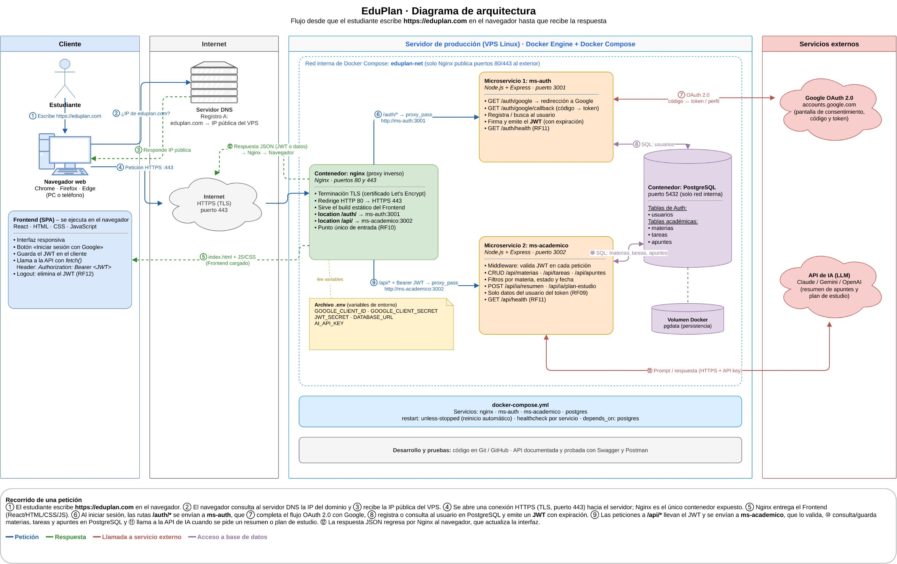
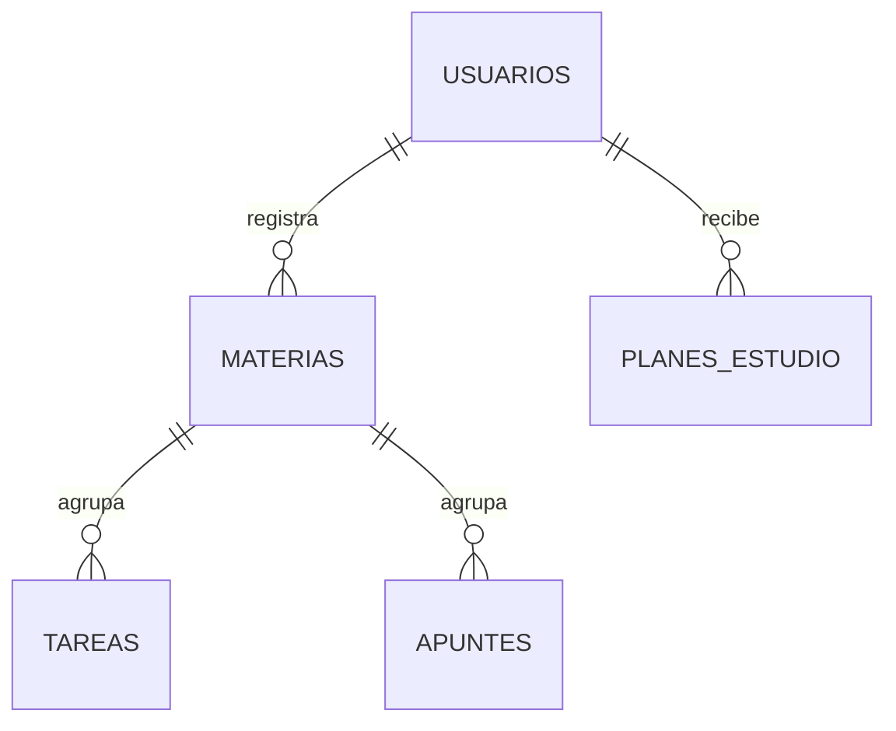

# EduPlan

**Sistema web para la organización académica con asistente de IA**

Universidad Mariano Gálvez de Guatemala · Desarrollo Web I · Ing. Guillermo Pisqui · Proyecto Final

---

## Descripción

EduPlan es una aplicación web basada en **microservicios** que permite a los estudiantes registrar sus materias, tareas y apuntes en un solo lugar. El acceso se realiza con **OAuth 2.0 (Google)** y la sesión se mantiene con **JSON Web Tokens (JWT)** con expiración.

Dos microservicios independientes (autenticación y gestión académica) se exponen a través de un **proxy inverso Nginx** y comparten una base de datos **PostgreSQL** con tablas separadas por servicio. Un asistente de IA resume apuntes y sugiere un plan de estudio según las entregas pendientes.

**Público objetivo:** estudiantes de nivel medio y universitario.

## Diagrama de arquitectura



Recorrido de una petición: el navegador resuelve `eduplan.com` por DNS, abre una conexión HTTPS con Nginx (único contenedor expuesto), Nginx entrega el frontend y enruta `/auth/*` a **ms-auth** y `/api/*` a **ms-academico**. ms-auth completa OAuth con Google y emite el JWT; ms-academico valida el JWT, consulta PostgreSQL y llama a la API de IA cuando se pide un resumen o un plan de estudio.

## Microservicios

### ms-auth · Autenticación y usuarios (Node.js + Express · puerto 3001)
| Método | Ruta | Descripción | Req. |
|---|---|---|---|
| GET | `/auth/google` | Redirige a la pantalla de consentimiento de Google | RF01 |
| GET | `/auth/google/callback` | Recibe el código de Google, registra/busca al usuario y emite el JWT | RF01, RF02 |
| GET | `/auth/me` | Devuelve el perfil del usuario del token | RF02 |
| POST | `/auth/logout` | Confirma el cierre de sesión; el cliente elimina el JWT | RF11 |
| GET | `/auth/health` | Estado del servicio y de la conexión a la base | HU10 |
| GET | `/auth/docs` | Documentación Swagger | — |

Esquema de BD: `auth` (tabla `usuarios`). Detalle completo en **[ms-auth/README.md](ms-auth/README.md)**.

### ms-academico · Materias, tareas, apuntes e IA (Node.js + Express · puerto 3002)
| Método | Ruta | Descripción | Req. |
|---|---|---|---|
| GET/POST | `/api/materias` | Listar / crear materias | RF03 |
| GET/PUT/DELETE | `/api/materias/:id` | Ver / editar / eliminar una materia | RF03 |
| GET/POST | `/api/tareas` | Listar (filtros `materiaId`, `estado`, `prioridad`, `desde`, `hasta`, `vencidas`) / crear tareas | RF04, RF06 |
| GET/PUT/DELETE | `/api/tareas/:id` | Ver / editar / eliminar una tarea | RF04 |
| PATCH | `/api/tareas/:id/estado` | Marcar como completada o cambiar estado | HU04 |
| GET/POST | `/api/apuntes` | Listar / crear apuntes por materia | RF05 |
| GET/PUT/DELETE | `/api/apuntes/:id` | Ver / editar / eliminar un apunte | RF05 |
| POST | `/api/ia/resumen/:apunteId` | Genera el resumen de un apunte con IA | RF07 |
| POST | `/api/ia/plan-estudio` | Sugiere un plan según tareas pendientes | RF08 |
| GET | `/api/ia/planes` | Historial de planes de estudio generados | RF08 |
| GET | `/api/resumen` | Totales para el panel principal | — |
| GET | `/api/health` | Estado del servicio, base de datos e IA | HU10 |
| GET | `/api/docs` | Documentación Swagger | — |

Todas las rutas (excepto `health` y `docs`) exigen `Authorization: Bearer <JWT>` y solo devuelven datos del usuario del token (RF09). Esquema de BD: `academico`. Detalle completo en **[ms-academico/README.md](ms-academico/README.md)**.

### nginx · Proxy inverso (puertos 80/443)
Punto único de entrada (RF10): sirve el frontend, enruta `/auth/` → ms-auth y `/api/` → ms-academico, y termina TLS.

### frontend · SPA (HTML, CSS, JavaScript)
Interfaz responsiva con inicio de sesión con Google, guarda el JWT en el cliente y lo elimina al cerrar sesión (RF11).

## Base de datos

PostgreSQL 16 compartido, con un **esquema por microservicio** y un **usuario de BD por microservicio** que solo puede ver su propio esquema. Modelo relacional, diccionario de datos y decisiones de diseño en **[database/README.md](database/README.md)**.



## Estructura del repositorio

```
eduplan/
├── database/          # Modelo relacional, scripts de inicialización y datos de prueba
├── ms-auth/           # Microservicio 1: OAuth 2.0 + JWT
├── ms-academico/      # Microservicio 2: materias, tareas, apuntes e IA
├── frontend/          # SPA (Fase 4)
├── nginx/             # Proxy inverso (Fase 5)
├── docs/              # Diagrama de arquitectura y documentación
├── docker-compose.yml
├── .env.example
└── README.md
```

## Tecnologías

Node.js + Express · PostgreSQL 16 · Nginx · Docker y Docker Compose · OAuth 2.0 (Google) + JWT · API de IA (Claude / Gemini / OpenAI) · Swagger y Postman · Git y GitHub.

## Cómo ejecutar

Requisito: Docker Desktop (o Docker Engine + Compose).

```bash
git clone https://github.com/<tu-usuario>/eduplan.git
cd eduplan
cp .env.example .env        # y cambiar las contraseñas
docker compose up -d
```

## Avance por fases

- [x] **Fase 1** · Base de datos (modelo relacional, scripts, roles, datos de prueba)
- [x] **Fase 2** · ms-auth (OAuth 2.0 + JWT)
- [x] **Fase 3** · ms-academico (CRUD, filtros, IA)
- [ ] **Fase 4** · Frontend
- [ ] **Fase 5** · Nginx, Docker Compose completo y despliegue
- [ ] **Fase 6** · Documentación de la API (Swagger / Postman)

## Convención de commits

Se usa **Conventional Commits**: `tipo(alcance): descripción en imperativo`.

| Tipo | Uso |
|---|---|
| `feat` | Nueva funcionalidad |
| `fix` | Corrección de un error |
| `docs` | Solo documentación |
| `style` | Formato, sin cambiar lógica |
| `refactor` | Reestructurar código sin cambiar comportamiento |
| `test` | Pruebas |
| `chore` | Configuración, dependencias, tareas de mantenimiento |
| `build` / `ci` | Docker, despliegue, integración continua |

Alcances: `db`, `auth`, `academico`, `frontend`, `nginx`, `docker`, `docs`.
Ejemplo: `feat(db): agregar tabla de tareas con prioridad y estado`.
