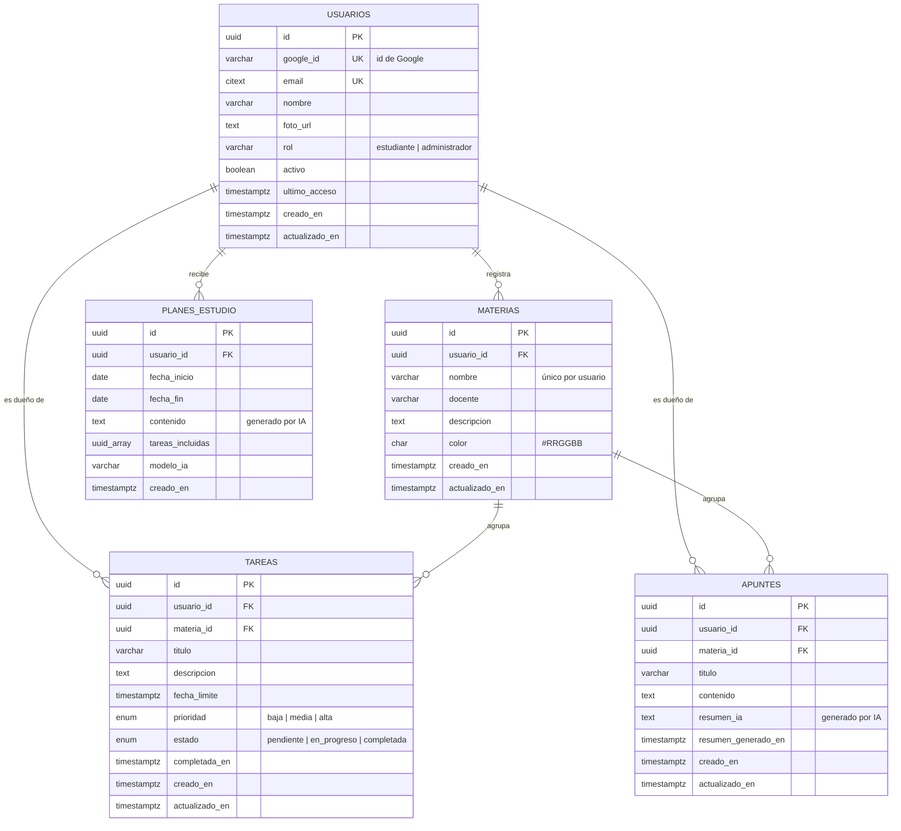

# Base de datos · EduPlan

Motor: **PostgreSQL 16** · Una sola instancia compartida por los dos microservicios, con las tablas **separadas por servicio mediante esquemas**.

| Esquema | Dueño | Tablas |
|---|---|---|
| `auth` | ms-auth | `usuarios` |
| `academico` | ms-academico | `materias`, `tareas`, `apuntes`, `planes_estudio` (+ vista `v_resumen_materias`) |

## Estructura de la carpeta

```
database/
├── init/                         # Se ejecuta automáticamente al crear el contenedor
│   ├── 01_schema.sql             # Esquemas, tipos, tablas, restricciones, índices, triggers y vista
│   └── 02_roles.sh               # Usuarios de BD por microservicio (contraseñas desde .env)
├── seeds/
│   └── seed_dev.sql              # Datos de prueba (solo desarrollo)
├── queries/
│   └── consultas_referencia.sql  # Consultas que usarán los microservicios
└── README.md
```

## Modelo relacional



Esquema relacional en notación textual (PK subrayada con `#`, FK con `→`):

```
auth.usuarios        (#id, google_id, email, nombre, foto_url, rol, activo, ultimo_acceso, creado_en, actualizado_en)
academico.materias   (#id, usuario_id → usuarios.id, nombre, docente, descripcion, color, creado_en, actualizado_en)
academico.tareas     (#id, usuario_id → usuarios.id, (materia_id, usuario_id) → materias(id, usuario_id),
                      titulo, descripcion, fecha_limite, prioridad, estado, completada_en, creado_en, actualizado_en)
academico.apuntes    (#id, usuario_id → usuarios.id, (materia_id, usuario_id) → materias(id, usuario_id),
                      titulo, contenido, resumen_ia, resumen_generado_en, creado_en, actualizado_en)
academico.planes_estudio (#id, usuario_id → usuarios.id, fecha_inicio, fecha_fin, contenido,
                      tareas_incluidas, modelo_ia, creado_en)
```

El modelo está en **3FN**: cada atributo depende solo de la llave primaria de su tabla, y no hay datos repetidos entre tablas (el nombre de la materia vive solo en `materias`).

## Diccionario de datos

### auth.usuarios — RF01, HU01
| Columna | Tipo | Nulo | Default | Descripción |
|---|---|---|---|---|
| id | UUID | No | `gen_random_uuid()` | PK. Viaja en el JWT como `sub` |
| google_id | VARCHAR(64) | No | | Id único que entrega Google. **UNIQUE** |
| email | CITEXT | No | | Correo de Google, sin distinguir mayúsculas. **UNIQUE**, validado con expresión regular |
| nombre | VARCHAR(150) | No | | Nombre mostrado |
| foto_url | TEXT | Sí | | Foto de perfil de Google |
| rol | VARCHAR(20) | No | `'estudiante'` | `estudiante` o `administrador` (HU10) |
| activo | BOOLEAN | No | `TRUE` | Permite bloquear el acceso sin borrar |
| ultimo_acceso | TIMESTAMPTZ | Sí | | Último inicio de sesión |
| creado_en / actualizado_en | TIMESTAMPTZ | No | `NOW()` | Auditoría (trigger) |

### academico.materias — RF03, HU02
| Columna | Tipo | Nulo | Default | Descripción |
|---|---|---|---|---|
| id | UUID | No | `gen_random_uuid()` | PK |
| usuario_id | UUID | No | | FK → `auth.usuarios.id` (ON DELETE CASCADE) |
| nombre | VARCHAR(120) | No | | Único por usuario, sin importar mayúsculas |
| docente | VARCHAR(120) | Sí | | Catedrático |
| descripcion | TEXT | Sí | | |
| color | CHAR(7) | No | `'#3B82F6'` | Hexadecimal `#RRGGBB` |
| creado_en / actualizado_en | TIMESTAMPTZ | No | `NOW()` | Auditoría |

### academico.tareas — RF04, RF06, HU03, HU04, HU05
| Columna | Tipo | Nulo | Default | Descripción |
|---|---|---|---|---|
| id | UUID | No | `gen_random_uuid()` | PK |
| usuario_id | UUID | No | | FK → `auth.usuarios.id` |
| materia_id | UUID | No | | FK compuesta `(materia_id, usuario_id)` → `materias(id, usuario_id)` |
| titulo | VARCHAR(200) | No | | |
| descripcion | TEXT | Sí | | |
| fecha_limite | TIMESTAMPTZ | No | | Fecha y hora de entrega |
| prioridad | ENUM `prioridad_tarea` | No | `'media'` | `baja`, `media`, `alta` |
| estado | ENUM `estado_tarea` | No | `'pendiente'` | `pendiente`, `en_progreso`, `completada` |
| completada_en | TIMESTAMPTZ | Sí | | Lo llena un trigger al completar; se limpia al reabrir |
| creado_en / actualizado_en | TIMESTAMPTZ | No | `NOW()` | Auditoría |

Índices: `(usuario_id, materia_id)`, `(usuario_id, estado)`, `(usuario_id, fecha_limite)` → uno por cada filtro de RF06.

### academico.apuntes — RF05, RF07, HU06, HU07
| Columna | Tipo | Nulo | Default | Descripción |
|---|---|---|---|---|
| id | UUID | No | `gen_random_uuid()` | PK |
| usuario_id | UUID | No | | FK → `auth.usuarios.id` |
| materia_id | UUID | No | | FK compuesta → `materias(id, usuario_id)` |
| titulo | VARCHAR(200) | No | | |
| contenido | TEXT | No | | Texto del apunte |
| resumen_ia | TEXT | Sí | | Último resumen generado por la IA |
| resumen_generado_en | TIMESTAMPTZ | Sí | | Se llena junto con `resumen_ia` (CHECK) |
| creado_en / actualizado_en | TIMESTAMPTZ | No | `NOW()` | Auditoría |

### academico.planes_estudio — RF08, HU08
| Columna | Tipo | Nulo | Default | Descripción |
|---|---|---|---|---|
| id | UUID | No | `gen_random_uuid()` | PK |
| usuario_id | UUID | No | | FK → `auth.usuarios.id` |
| fecha_inicio / fecha_fin | DATE | No | hoy / — | Rango del plan (`fecha_fin >= fecha_inicio`) |
| contenido | TEXT | No | | Plan devuelto por la IA |
| tareas_incluidas | UUID[] | No | `'{}'` | Tareas pendientes enviadas a la IA |
| modelo_ia | VARCHAR(80) | Sí | | Modelo usado |
| creado_en | TIMESTAMPTZ | No | `NOW()` | |

### Vista academico.v_resumen_materias
Por cada materia: total de tareas, pendientes, en progreso, completadas, vencidas y la próxima fecha de entrega. Pensada para el panel principal del frontend.

## Decisiones de diseño

- **UUID como llave primaria**: no revela cuántos registros existen ni permite adivinar IDs de otros usuarios en la URL (`/api/tareas/5`).
- **Seguridad por usuario (RF09) en la propia base**: cada tabla académica guarda `usuario_id`, y la FK compuesta `(materia_id, usuario_id)` impide que una tarea o apunte apunte a la materia de otro estudiante, aunque el backend tuviera un error.
- **Un usuario de BD por microservicio**: `ms_auth` solo accede al esquema `auth` y `ms_academico` solo al esquema `academico`. Las contraseñas vienen del `.env`.
- **Borrado en cascada**: si se elimina un usuario se eliminan sus materias, tareas, apuntes y planes; si se elimina una materia, sus tareas y apuntes.
- **TIMESTAMPTZ** con zona `America/Guatemala` para que las fechas de entrega sean correctas sin importar dónde esté el servidor.
- **No se guardan contraseñas ni tokens**: Google valida la identidad y el JWT vive en el cliente (RF11: cerrar sesión = eliminar el JWT del cliente).

## Comandos útiles

```bash
# Levantar la base (crea esquema y roles la primera vez)
docker compose up -d postgres

# Ver logs de la inicialización
docker compose logs postgres

# Cargar datos de prueba (funciona igual en PowerShell, CMD y Linux)
docker compose cp database/seeds/seed_dev.sql postgres:/tmp/seed_dev.sql
docker compose exec postgres psql -U eduplan_admin -d eduplan -f /tmp/seed_dev.sql

# Entrar a la consola SQL
docker compose exec postgres psql -U eduplan_admin -d eduplan

# Recrear la base desde cero (BORRA todos los datos)
docker compose down -v
docker compose up -d postgres
```

Dentro de `psql`: `\dn` lista esquemas, `\dt auth.*` y `\dt academico.*` listan tablas, `\d academico.tareas` muestra la estructura de una tabla.
