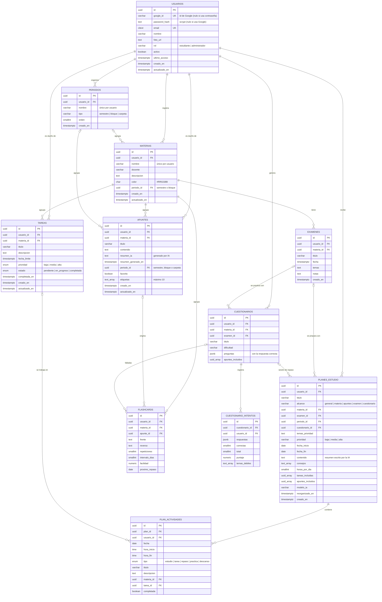

# Base de datos · EduPlan

Motor: **PostgreSQL 16** · Una sola instancia compartida por los dos microservicios, con las tablas **separadas por servicio mediante esquemas**.

| Esquema | Dueño | Tablas |
|---|---|---|
| `auth` | ms-auth | `usuarios` |
| `academico` | ms-academico | `periodos`, `materias`, `tareas`, `apuntes`, `examenes`, `planes_estudio`, `plan_actividades`, `cuestionarios`, `cuestionario_intentos`, `flashcards` (+ vista `v_resumen_materias`) |

## Estructura de la carpeta

```
database/
├── init/                         # Se ejecuta automáticamente al crear el contenedor
│   ├── 01_schema.sql             # Esquemas, tipos, tablas, restricciones, índices, triggers y vista
│   ├── 02_roles.sh               # Usuarios de BD por microservicio (contraseñas desde .env)
│   ├── 03_mejoras.sql            # Versión 2: contraseñas, exámenes, planes por día, cuestionarios, tarjetas
│   └── 04_organizacion.sql       # Versión 3: semestres/bloques, favoritos, etiquetas y conexión entre secciones
├── seeds/
│   └── seed_dev.sql              # Datos de prueba (solo desarrollo)
├── queries/
│   └── consultas_referencia.sql  # Consultas que usarán los microservicios
└── README.md
```

## Modelo relacional



Esquema relacional en notación textual (PK subrayada con `#`, FK con `→`):

```
auth.usuarios        (#id, google_id, email, nombre, foto_url, rol, activo, ultimo_acceso, creado_en, actualizado_en)
academico.materias   (#id, usuario_id → usuarios.id, nombre, docente, descripcion, color, creado_en, actualizado_en)
academico.tareas     (#id, usuario_id → usuarios.id, (materia_id, usuario_id) → materias(id, usuario_id),
                      titulo, descripcion, fecha_limite, prioridad, estado, completada_en, creado_en, actualizado_en)
academico.apuntes    (#id, usuario_id → usuarios.id, (materia_id, usuario_id) → materias(id, usuario_id),
                      titulo, contenido, resumen_ia, resumen_generado_en, creado_en, actualizado_en)
academico.planes_estudio (#id, usuario_id → usuarios.id, fecha_inicio, fecha_fin, contenido,
                      tareas_incluidas, modelo_ia, creado_en)
```

Tablas de la versión 2 (`03_mejoras.sql`):

```
academico.examenes              (#id, (materia_id, usuario_id) → materias, titulo, fecha, temas, notas, ...)
academico.plan_actividades      (#id, (plan_id, usuario_id) → planes_estudio, fecha, hora_inicio, hora_fin, tipo, titulo,
                                 descripcion, (materia_id, usuario_id) → materias, (tarea_id, usuario_id) → tareas, completada)
academico.cuestionarios         (#id, usuario_id → usuarios, (materia_id, usuario_id) → materias,
                                 (examen_id, usuario_id) → examenes, titulo, dificultad, preguntas, ...)
academico.cuestionario_intentos (#id, (cuestionario_id, usuario_id) → cuestionarios, respuestas, correctas, total, puntaje, temas_debiles)
academico.flashcards            (#id, (materia_id, usuario_id) → materias, (apunte_id, usuario_id) → apuntes, frente, reverso,
                                 repeticiones, intervalo_dias, facilidad, proximo_repaso, ...)
```

El modelo está en **3FN**: cada atributo depende solo de la llave primaria de su tabla, y no hay datos repetidos entre tablas (el nombre de la materia vive solo en `materias`).

## Diccionario de datos

### auth.usuarios — RF01, HU01
| Columna | Tipo | Nulo | Default | Descripción |
|---|---|---|---|---|
| id | UUID | No | `gen_random_uuid()` | PK. Viaja en el JWT como `sub` |
| google_id | VARCHAR(64) | Sí | | Id único que entrega Google. **UNIQUE**. Nulo si la cuenta solo usa contraseña |
| password_hash | TEXT | Sí | | Hash scrypt con sal (`scrypt$N$r$p$sal$hash`). Nulo si la cuenta solo usa Google |
| email | CITEXT | No | | Correo de Google, sin distinguir mayúsculas. **UNIQUE**, validado con expresión regular |
| nombre | VARCHAR(150) | No | | Nombre mostrado |
| foto_url | TEXT | Sí | | Foto de perfil de Google |
| rol | VARCHAR(20) | No | `'estudiante'` | `estudiante` o `administrador` (HU10) |
| activo | BOOLEAN | No | `TRUE` | Permite bloquear el acceso sin borrar |
| ultimo_acceso | TIMESTAMPTZ | Sí | | Último inicio de sesión |
| creado_en / actualizado_en | TIMESTAMPTZ | No | `NOW()` | Auditoría (trigger) |

CHECK `ck_usuarios_metodo_acceso`: toda cuenta tiene Google, contraseña o ambos.

### academico.periodos — organización (versión 3)
| Columna | Tipo | Nulo | Default | Descripción |
|---|---|---|---|---|
| id | UUID | No | `gen_random_uuid()` | PK |
| usuario_id | UUID | No | | FK → `auth.usuarios.id` (ON DELETE CASCADE) |
| nombre | VARCHAR(80) | No | | Único por usuario, sin importar mayúsculas (`Semestre 2`, `Bloque 1`, `Proyecto final`) |
| tipo | VARCHAR(10) | No | `'semestre'` | CHECK: `semestre`, `bloque`, `carpeta` |
| orden | SMALLINT | No | 0 | Posición en el menú |

Las materias y los apuntes tienen `periodo_id` con FK compuesta `(periodo_id, usuario_id)` y `ON DELETE SET NULL (periodo_id)`: si se elimina un semestre, sus materias y apuntes **no se borran**, quedan "sin semestre". Un apunte nuevo toma el semestre de su materia si no se elige otro.

### academico.materias — RF03, HU02
| Columna | Tipo | Nulo | Default | Descripción |
|---|---|---|---|---|
| id | UUID | No | `gen_random_uuid()` | PK |
| usuario_id | UUID | No | | FK → `auth.usuarios.id` (ON DELETE CASCADE) |
| nombre | VARCHAR(120) | No | | Único por usuario, sin importar mayúsculas |
| docente | VARCHAR(120) | Sí | | Catedrático |
| descripcion | TEXT | Sí | | |
| color | CHAR(7) | No | `'#3B82F6'` | Hexadecimal `#RRGGBB` |
| creado_en / actualizado_en | TIMESTAMPTZ | No | `NOW()` | Auditoría |

### academico.tareas — RF04, RF06, HU03, HU04, HU05
| Columna | Tipo | Nulo | Default | Descripción |
|---|---|---|---|---|
| id | UUID | No | `gen_random_uuid()` | PK |
| usuario_id | UUID | No | | FK → `auth.usuarios.id` |
| materia_id | UUID | No | | FK compuesta `(materia_id, usuario_id)` → `materias(id, usuario_id)` |
| titulo | VARCHAR(200) | No | | |
| descripcion | TEXT | Sí | | |
| fecha_limite | TIMESTAMPTZ | No | | Fecha y hora de entrega |
| prioridad | ENUM `prioridad_tarea` | No | `'media'` | `baja`, `media`, `alta` |
| estado | ENUM `estado_tarea` | No | `'pendiente'` | `pendiente`, `en_progreso`, `completada` |
| completada_en | TIMESTAMPTZ | Sí | | Lo llena un trigger al completar; se limpia al reabrir |
| creado_en / actualizado_en | TIMESTAMPTZ | No | `NOW()` | Auditoría |

Índices: `(usuario_id, materia_id)`, `(usuario_id, estado)`, `(usuario_id, fecha_limite)` → uno por cada filtro de RF06.

Trigger `trg_tareas_bloquear_completadas`: si la tarea ya está completada, cualquier `UPDATE` falla con el error `TAREA_COMPLETADA`. Así la regla "una tarea completada no se modifica" se cumple aunque alguien intente saltarse el backend.

### academico.apuntes — RF05, RF07, HU06, HU07
| Columna | Tipo | Nulo | Default | Descripción |
|---|---|---|---|---|
| id | UUID | No | `gen_random_uuid()` | PK |
| usuario_id | UUID | No | | FK → `auth.usuarios.id` |
| materia_id | UUID | No | | FK compuesta → `materias(id, usuario_id)` |
| titulo | VARCHAR(200) | No | | |
| contenido | TEXT | No | | Texto del apunte |
| resumen_ia | TEXT | Sí | | Último resumen generado por la IA |
| resumen_generado_en | TIMESTAMPTZ | Sí | | Se llena junto con `resumen_ia` (CHECK) |
| periodo_id | UUID | Sí | | Semestre, bloque o carpeta (FK compuesta, SET NULL) |
| favorito | BOOLEAN | No | `FALSE` | Índice parcial `WHERE favorito` |
| etiquetas | TEXT[] | No | `'{}'` | CHECK: máximo 10. Índice GIN para filtrar |
| creado_en / actualizado_en | TIMESTAMPTZ | No | `NOW()` | Auditoría |

### academico.planes_estudio — RF08, HU08
| Columna | Tipo | Nulo | Default | Descripción |
|---|---|---|---|---|
| id | UUID | No | `gen_random_uuid()` | PK |
| usuario_id | UUID | No | | FK → `auth.usuarios.id` |
| titulo | VARCHAR(200) | Sí | | Título del plan |
| alcance | VARCHAR(20) | No | `'general'` | `general`, `materia`, `apuntes` o `examen` |
| materia_id / examen_id | UUID | Sí | | FK compuestas → materia o examen del plan |
| fecha_inicio / fecha_fin | DATE | No | | Rango del plan |
| contenido | TEXT | No | | Resumen de la estrategia escrito por la IA |
| consejos | TEXT[] | No | `'{}'` | Consejos de la IA |
| horas_por_dia | SMALLINT | Sí | | Horas de estudio por día elegidas |
| tareas_incluidas / apuntes_incluidos | UUID[] | No | `'{}'` | Contexto enviado a la IA |
| modelo_ia | VARCHAR(80) | Sí | | Proveedor y modelo usados |
| reorganizado_en | TIMESTAMPTZ | Sí | | Última reorganización aplicada |

### academico.plan_actividades — RF08
| Columna | Tipo | Nulo | Descripción |
|---|---|---|---|
| id | UUID | No | PK |
| plan_id + usuario_id | UUID | No | FK compuesta → `planes_estudio` (CASCADE) |
| fecha | DATE | No | Día de la actividad |
| hora_inicio / hora_fin | TIME | No | CHECK `hora_fin > hora_inicio` |
| tipo | ENUM `tipo_actividad` | No | `estudio`, `tarea`, `repaso`, `practica`, `descanso` |
| titulo / descripcion | VARCHAR(200) / TEXT | No / Sí | Qué hacer en la sesión |
| materia_id / tarea_id | UUID | Sí | FK compuestas (SET NULL solo en esa columna si se borra la materia o tarea) |
| completada / completada_en | BOOLEAN / TIMESTAMPTZ | No / Sí | Avance del estudiante |

### academico.examenes
| Columna | Tipo | Nulo | Descripción |
|---|---|---|---|
| id | UUID | No | PK |
| usuario_id, materia_id | UUID | No | FK compuesta → `materias(id, usuario_id)` |
| titulo | VARCHAR(200) | No | Ej. "Segundo parcial" |
| fecha | TIMESTAMPTZ | No | Fecha y hora del examen |
| temas / notas | TEXT | Sí | Temas (uno por línea) y notas |

### academico.cuestionarios y academico.cuestionario_intentos
| Columna | Tipo | Descripción |
|---|---|---|
| preguntas | JSONB | `[{ pregunta, opciones[4], correcta, explicacion, tema }]`. CHECK: arreglo no vacío. La respuesta correcta **nunca** se envía al cliente antes de calificar |
| dificultad | VARCHAR(10) | `facil`, `media`, `dificil` |
| materia_id / examen_id | UUID | Origen del cuestionario (FK compuestas) |
| intentos.respuestas | JSONB | Índice elegido en cada pregunta (o `null`) |
| intentos.correctas / total / puntaje | SMALLINT / NUMERIC(5,2) | CHECK `puntaje BETWEEN 0 AND 100` |
| intentos.temas_debiles | TEXT[] | Temas fallados; alimentan el plan de preparación de exámenes |
| temas | TEXT[] | Temas del examen que el estudiante eligió (versión 3) |
| preguntas[].apunteId | UUID en JSON | Apunte de donde salió cada pregunta (versión 3) |
| intentos.apuntes_recomendados | UUID[] | Apuntes de las preguntas falladas: se recomiendan para repasar y marcan el apunte como "por repasar" |

### academico.flashcards
| Columna | Tipo | Default | Descripción |
|---|---|---|---|
| frente / reverso | TEXT | | Pregunta y respuesta |
| materia_id / apunte_id | UUID | | FK compuestas (el apunte se pone en NULL si se borra) |
| repeticiones | SMALLINT | 0 | Repasos exitosos seguidos |
| intervalo_dias | SMALLINT | 0 | Días hasta el siguiente repaso |
| facilidad | NUMERIC(4,2) | 2.50 | Factor SM-2 (CHECK entre 1.30 y 3.50) |
| proximo_repaso | DATE | hoy | Cuándo vuelve a mostrarse |
| cuestionario_id | UUID | | Si se creó desde preguntas falladas (evita duplicados) |

### Vista academico.v_resumen_materias
Por cada materia: total de tareas, pendientes, en progreso, completadas, vencidas y la próxima fecha de entrega. Pensada para el panel principal del frontend.

## Decisiones de diseño

- **UUID como llave primaria**: no revela cuántos registros existen ni permite adivinar IDs de otros usuarios en la URL (`/api/tareas/5`).
- **Seguridad por usuario (RF09) en la propia base**: cada tabla académica guarda `usuario_id`, y la FK compuesta `(materia_id, usuario_id)` impide que una tarea o apunte apunte a la materia de otro estudiante, aunque el backend tuviera un error.
- **Un usuario de BD por microservicio**: `ms_auth` solo accede al esquema `auth` y `ms_academico` solo al esquema `academico`. Las contraseñas vienen del `.env`.
- **Borrado en cascada**: si se elimina un usuario se eliminan sus materias, tareas, apuntes y planes; si se elimina una materia, sus tareas y apuntes.
- **TIMESTAMPTZ** con zona `America/Guatemala` para que las fechas de entrega sean correctas sin importar dónde esté el servidor.
- **Contraseñas solo como hash scrypt con sal**; los tokens no se guardan (el JWT vive en el cliente y cerrar sesión lo elimina, RF11).
- **Reglas de negocio en la base**: el trigger de tareas completadas, los CHECK de horarios, puntajes y facilidad, y las FK compuestas de todas las tablas nuevas.
- **Migración segura**: `03_mejoras.sql` y `04_organizacion.sql` usan `IF NOT EXISTS` y se pueden ejecutar varias veces sobre una base con datos.
- **Organización sin perder datos**: semestres y bloques son opcionales; borrarlos deja materias y apuntes "sin semestre" en lugar de borrarlos.

## Comandos útiles

```bash
# Levantar la base (crea esquema y roles la primera vez)
docker compose up -d postgres

# Ver logs de la inicialización
docker compose logs postgres

# Cargar datos de prueba (funciona igual en PowerShell, CMD y Linux)
docker compose cp database/seeds/seed_dev.sql postgres:/tmp/seed_dev.sql
docker compose exec postgres psql -U eduplan_admin -d eduplan -f /tmp/seed_dev.sql

# Actualizar una base existente a la versión 2 y 3 (no borra datos)
docker compose cp database/init/03_mejoras.sql postgres:/tmp/03_mejoras.sql
docker compose exec postgres psql -U eduplan_admin -d eduplan -f /tmp/03_mejoras.sql
docker compose cp database/init/04_organizacion.sql postgres:/tmp/04_organizacion.sql
docker compose exec postgres psql -U eduplan_admin -d eduplan -f /tmp/04_organizacion.sql

# Conectarte con DBeaver o pgAdmin (localhost:5433): la base ya no publica
# su puerto por defecto; levanta el proyecto en modo desarrollo
docker compose -f docker-compose.yml -f docker-compose.dev.yml up -d

# Entrar a la consola SQL
docker compose exec postgres psql -U eduplan_admin -d eduplan

# Recrear la base desde cero (BORRA todos los datos)
docker compose down -v
docker compose up -d postgres
```

Dentro de `psql`: `\dn` lista esquemas, `\dt auth.*` y `\dt academico.*` listan tablas, `\d academico.tareas` muestra la estructura de una tabla.
