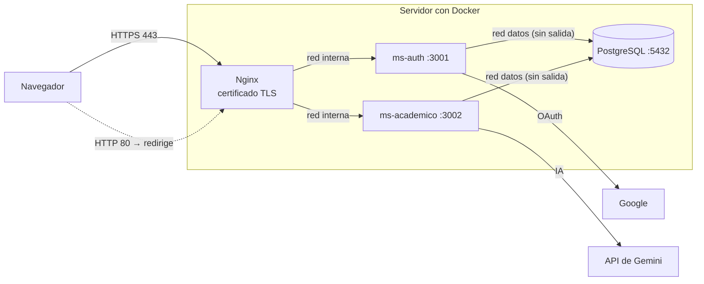

# Despliegue de EduPlan en un servidor

Guía para publicar EduPlan en internet con un **dominio propio y HTTPS real** (Let's Encrypt).
Para usarlo en tu computadora no necesitas esta guía: basta con `docker compose up -d --build` y abrir https://localhost.

> Los pasos de Let's Encrypt (5 y 8) dependen de tu dominio y servidor, así que no se pudieron probar en el entorno de desarrollo. El resto de la configuración (HTTPS, redirección, cabeceras, límites y redes) sí está probada.

## Arquitectura en producción



Solo los puertos **80 y 443** quedan abiertos. Los microservicios y la base no publican puertos, y PostgreSQL está en una red `internal` de Docker: ni siquiera tiene salida a internet.

## Requisitos

- Un servidor Linux (por ejemplo Ubuntu 24.04) con al menos 1 GB de RAM.
- Un dominio (por ejemplo `eduplan.com`).
- Docker y Docker Compose instalados en el servidor.

## Pasos

### 1. Apuntar el dominio al servidor
En el panel de tu dominio crea un registro **A** con el nombre `@` (o `www`) y la IP pública del servidor. Puede tardar unos minutos en propagarse.

### 2. Abrir solo los puertos necesarios
```bash
sudo ufw allow OpenSSH
sudo ufw allow 80/tcp
sudo ufw allow 443/tcp
sudo ufw enable
```

### 3. Descargar el proyecto y configurar el `.env`
```bash
git clone https://github.com/jaquelinerodas/EduPlan.git
cd EduPlan
cp .env.example .env
nano .env
```
Valores que cambian en producción:

| Variable | Valor |
|---|---|
| `NODE_ENV` | `production` (oculta la página de prueba `/auth/prueba`) |
| `DOMINIO` | `eduplan.com` |
| `GOOGLE_CALLBACK_URL` | `https://eduplan.com/auth/google/callback` |
| `FRONTEND_URL` | `https://eduplan.com/` |
| Contraseñas y `JWT_SECRET` | Nuevas, largas y aleatorias (no reutilices las de desarrollo) |

Genera valores aleatorios con: `openssl rand -base64 48`

### 4. Registrar el dominio en Google Cloud Console
En **Google Auth Platform → Clientes → tu cliente web**:
- Orígenes de JavaScript autorizados: `https://eduplan.com`
- URI de redireccionamiento autorizados: `https://eduplan.com/auth/google/callback`

En **Público**, publica la aplicación para que cualquier cuenta de Google pueda entrar (mientras está "en prueba" solo entran los usuarios de prueba).

### 5. Levantar EduPlan
```bash
docker compose up -d --build
docker compose ps
```
La primera vez Nginx crea un certificado autofirmado para que el sitio arranque. El siguiente paso lo reemplaza por uno real.

### 6. Obtener el certificado de Let's Encrypt
```bash
docker run --rm \
  -v "$PWD/nginx/acme:/var/www/acme" \
  -v eduplan_letsencrypt:/etc/letsencrypt \
  certbot/certbot certonly --webroot -w /var/www/acme \
  -d eduplan.com --email tu-correo@gmail.com --agree-tos --no-eff-email
```
Let's Encrypt comprueba el dominio por `http://eduplan.com/.well-known/acme-challenge/`, que Nginx ya sirve.

### 7. Instalar el certificado en Nginx
```bash
docker run --rm \
  -v eduplan_letsencrypt:/etc/letsencrypt \
  -v "$PWD/nginx/certs:/certs" \
  alpine sh -c 'cp -L /etc/letsencrypt/live/eduplan.com/fullchain.pem /certs/eduplan.crt && cp -L /etc/letsencrypt/live/eduplan.com/privkey.pem /certs/eduplan.key'
docker compose exec nginx nginx -s reload
```
Abre https://eduplan.com: ya no debe aparecer ninguna advertencia. Con un dominio real, Nginx agrega también la cabecera **HSTS**.

### 8. Renovación automática
Los certificados de Let's Encrypt duran 90 días. Guarda los pasos 6 (con `renew` en lugar de `certonly ...`) y 7 en un script y prográmalo con `crontab -e`:
```
0 3 * * 1 cd /ruta/EduPlan && ./renovar-certificado.sh >> renovacion.log 2>&1
```

## Copias de seguridad de la base

```bash
# Respaldo
docker compose exec postgres pg_dump -U eduplan_admin -d eduplan -Fc -f /tmp/eduplan.dump
docker compose cp postgres:/tmp/eduplan.dump ./respaldos/eduplan-$(date +%F).dump

# Restaurar
docker compose cp ./respaldos/eduplan-2026-11-01.dump postgres:/tmp/eduplan.dump
docker compose exec postgres pg_restore -U eduplan_admin -d eduplan --clean /tmp/eduplan.dump
```

## Actualizar a una nueva versión

```bash
git pull
docker compose up -d --build
# Si la versión trae cambios de base de datos (por ejemplo 04_organizacion.sql):
docker compose cp database/init/04_organizacion.sql postgres:/tmp/04.sql
docker compose exec postgres psql -U eduplan_admin -d eduplan -f /tmp/04.sql
```

## Lista de verificación de seguridad

- [ ] `NODE_ENV=production`
- [ ] Contraseñas y `JWT_SECRET` nuevos y aleatorios
- [ ] `.env` y certificados fuera de Git (`git ls-files` no los muestra)
- [ ] Solo los puertos 22, 80 y 443 abiertos en el firewall
- [ ] Certificado de Let's Encrypt instalado y renovación programada
- [ ] Sin `docker-compose.dev.yml` en el servidor (no abre los puertos internos)
- [ ] Respaldo de la base programado
